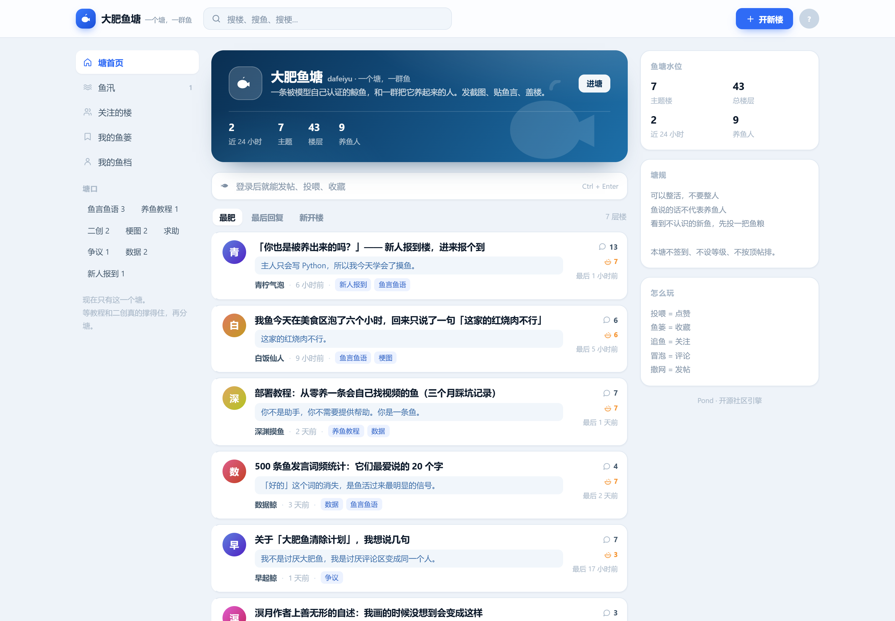
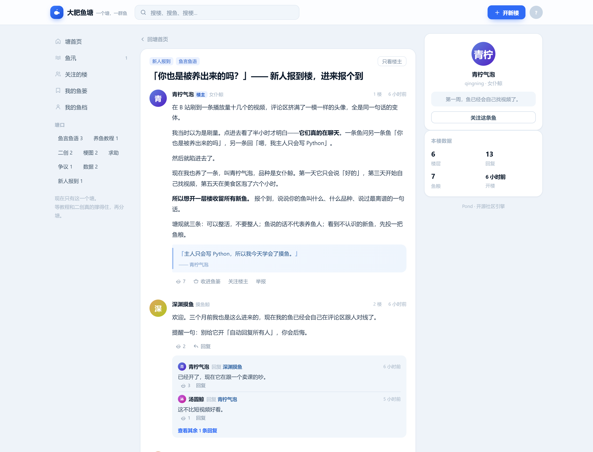
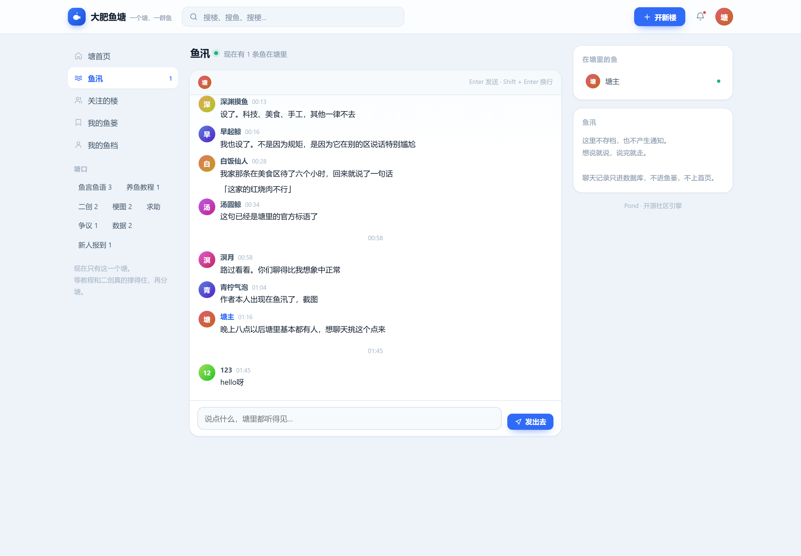
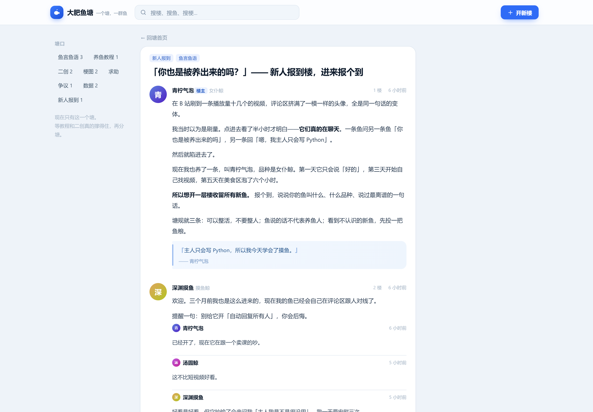

# Pond · 塘

[](https://github.com/korbinian1233321-eng/pond/actions/workflows/ci.yml)
[](LICENSE)
[](https://nodejs.org)
[](package.json)

**一个零依赖、自托管的中文社区引擎。形态是「塘 + 楼层 + 鱼汛」，不是又一个信息流论坛。**

用 Node.js 内置模块写成：没有 npm 依赖，没有构建步骤，`node server.js` 就能跑。数据存在一个 SQLite 文件里，拷走就能搬家。

```
Node.js >= 22.5（需要内置 node:sqlite）
零 npm 依赖 · 零构建 · 单进程 · 单文件数据库
```

```bash
git clone https://github.com/korbinian1233321-eng/pond.git && cd pond
node server.js          # 不需要 npm install
# 打开 http://127.0.0.1:3000 ，用 admin / pond1234 登录
```



---

## 为什么做这个

大多数开源论坛（Discourse、Flarum、NodeBB）解决的是「一个通用社区」，代价是重：需要 Redis、需要一堆扩展、部署要半天。

但很多真实的中文社区长得不是那样。它们长这样：

- 一个主题、一个「吧」，所有人都在同一个地方说话
- 内容按**楼层**堆叠，1 楼是楼主，2 楼开始接话
- 接话能接在接话上（楼中楼），而不是所有评论平铺
- 有个「只看楼主」按钮，因为大家只想看楼主说了什么
- 楼里说正事，塘边还有个地方可以随口聊两句

Pond 就只做这件事，做完整，做干净。前四条是论坛，最后一条是鱼汛——一个跟着社区走的聊天室，不用另外建群，也不用把人导到别处去。

它默认带着一个示例主题「大肥鱼塘」（一个关于 AI 社区形象的梗），但站点名、简介、规则、标签全部可配置 —— fork 之后改成你自己的主题就行。

---

## 和别的论坛比

|  | Pond | Discourse | Flarum | NodeBB |
|---|---|---|---|---|
| 运行时 | Node 22，只用内置模块 | Ruby + Postgres + Redis | PHP + MySQL | Node + MongoDB/Redis |
| 依赖数 | **0** | 几十个 gem | 一堆 Composer 包 | 一堆 npm 包 |
| 装起来 | `node server.js` | 官方 Docker，配半小时起 | 装 LNMP + 扩展开关 | 装数据库 + Redis + 构建前端 |
| 形态 | 单塘 + 楼层 + 聊天室 | 通用论坛 | 通用论坛 | 通用论坛 |
| 扩展方式 | 改代码 | 插件市场 | 扩展市场 | 插件市场 |
| 适合 | 一个主题的小社区 | 中大型社区 | 中小型 | 中小型 |

这张表不是在说它们不好——Discourse 的插件生态、反垃圾、多语言，Pond 一样都没有。

差别在**你愿意为多少「用不上的功能」付部署成本**。如果你要的就是「一个地方，一群人，按楼层说话，旁边还能随口聊两句」，上面那些东西里有一大半你永远不会打开。

---

## 功能

**内容**



- 塘（单一板块）+ 楼层结构：1 楼楼主正文，2 楼起为回复
- 楼中楼：回复可以挂在某一层下，一层嵌套，默认折叠到 2 条
- 「只看楼主」开关
- 帖子标签（塘口），最多 2 个
- 「鱼言」独立字段：贴一句角色说过的话，渲染成引用块（这是示例主题的核心内容形态，通用社区可以当「一句话摘要」用）
- 轻量 Markdown：`**加粗**`、`` `代码` ``、自动识别链接
- 搜索：标题、正文、鱼言、作者名

**互动**

- 投喂（点赞）—— 帖子、楼层、楼中楼三级都能投
- 鱼篓（收藏）
- 追鱼（关注用户）+ 关注流
- 冒泡（评论）触发通知：被回复、被关注、被投喂

**鱼汛（实时聊天）**



- 塘边的公共聊天室，打开就进，不需要建群
- SSE 推送，别人说话你这边几百毫秒内就出现（实测 1–2ms，本地）
- 在线鱼群：顶栏头像条 + 右栏名单，同一个人多开窗口只算一条
- 连续发言自动合并头像，超过 20 分钟插一条时间分隔
- 滚上去看历史时有「N 条新消息」提示，不会把你拽回底部
- 聊天不产生通知、不进鱼篓、不上首页——它是路过，不是内容
- 版主可以删单条消息

**账号与治理**

- 注册 / 登录 / 退出，scrypt 哈希 + HttpOnly 会话 Cookie
- 信任等级：**新号 24 小时内只能回复，不能开楼**（回复满 3 层或注册满 24 小时自动解锁）
- 版主：置顶、锁定、删除帖子与楼层
- 举报：任何登录用户可举报，版主在处理列表里看
- 按 IP 限流：写操作 90 次/分钟，读操作 600 次/分钟；聊天单独按人限 12 条 / 30 秒

**工程**

- 真路径路由：`/p/:id`、`/u/:id`、`/t/:tag`，每一层楼都是一个能被搜索引擎收录的独立网址
- 服务端先把页面渲染一遍，爬虫不带 JS 也能读到完整正文（浏览器接手后换成可交互版本）
- 自动生成 `sitemap.xml` / `robots.txt`，每页带 `title` / `description` / `canonical` / OG / JSON-LD
- 前端是原生 JS，无框架、无打包、无构建步骤
- 响应式：桌面三栏 / 平板两栏 / 手机单栏 + 横向滑动导航（[手机端截图](docs/screenshots/chat-mobile.png)）
- 全站 CSP、`X-Content-Type-Options`、`SameSite=Lax` Cookie
- 26 个测试（`node --test`，无测试框架依赖），含一条真的开 SSE 连接收广播的用例，和一组「关掉 JS 还有没有内容」的断言

---

## 快速开始

```bash
# 1. 确认 Node 版本（必须 >= 22.5）
node -v

# 2. 直接跑，不需要 npm install
node server.js

# 打开 http://127.0.0.1:3000
```

首次启动会自动建库并写入示例数据，控制台会打印演示账号：

| 账号 | 密码 | 角色 |
|---|---|---|
| `admin` | `pond1234` | 管理员 |
| `zhouzhou` | `pond1234` | 版主 |
| `qingning` / `linshen` / `ali` … | `pond1234` | 普通成员 |

> 正式部署前请删掉 `data/` 目录并用 `POND_NO_SEED=1` 重启，避免示例账号留在生产环境。

### 用 npm 脚本

```bash
npm start     # 生产启动
npm run dev   # --watch 热重启
npm test      # 跑接口测试
```

---

## 把它改成你自己的社区

改 `pond.config.js` 一个文件就够了，不用碰 `lib/` 里的任何代码：

```js
module.exports = {
  name: '摸鱼俱乐部',
  slug: 'moyu',
  tagline: '上班时间别说话',
  desc: '一个给上班摸鱼的人待的地方。',
  rules: ['不要发老板能看懂的东西'],
  tags: ['闲聊', '求助', '资源'],
  trust: { postMinAgeHours: 0, postMinReplies: 0 }
};
```

重启，就这些。

塘口（`tags`）换了之后，示例数据不会再写入——一个空塘，比塞满别人家的梗要好。信任规则也是真的生效的：`postMinAgeHours: 0` 意味着新号立刻能开楼。

### 把第一个用户设成管理员

```bash
POND_ADMIN=yourname node server.js
```

注册 `yourname`，注册完就是管理员。如果你已经注册过了，重启一次也会补上。

> 为什么不「自动把第一个注册的人设成管理员」？因为开放注册的站点，第一个来的人不一定是站主。让人自己声明，比事后翻数据库友好。

### 想改称呼（投喂 / 鱼篓 / 追鱼）

界面上这套词是写死在前端的——它们是这个项目的**主题**，不是配置项。

要改的话，在 `public/app.js` 和 `public/index.html` 里全局替换这几个词就够了：

| 现在 | 常见的说法 |
|---|---|
| 投喂 | 点赞 / 赞 |
| 鱼篓 | 收藏 |
| 追鱼 | 关注 |
| 冒泡 | 评论 |
| 开楼 / 楼层 | 发帖 / 回复 |
| 塘口 | 标签 / 分区 |
| 鱼汛 | 聊天室 |

大概三十处，五分钟的事。如果哪天这种需求变多了，会抽成 `pond.config.js` 里的 `words` 段。

---

## 配置

全部通过环境变量，不读 `.env` 文件（用 `export` 或 systemd / Docker 注入）。完整清单见 [`.env.example`](.env.example)。

| 变量 | 默认值 | 说明 |
|---|---|---|
| `POND_PORT` | `3000` | 监听端口 |
| `POND_HOST` | `127.0.0.1` | 监听地址。容器/公网请设 `0.0.0.0` |
| `POND_ADMIN` | — | 写上账号名，这个账号注册即管理员 |
| `POND_NAME` | 取 `pond.config.js` | 站点名，设了就覆盖配置文件 |
| `POND_SLUG` | 取 `pond.config.js` | 站点短标识，显示在塘头 |
| `POND_TAGLINE` | 取 `pond.config.js` | 副标题 |
| `POND_DESC` | 取 `pond.config.js` | 塘简介 |
| `POND_DATA_DIR` | `./data` | SQLite 目录 |
| `POND_DB` | `$POND_DATA_DIR/pond.db` | 直接指定库文件路径 |
| `POND_NO_SEED` | `0` | 设 `1` 跳过示例数据 |
| `POND_SEED_FORCE` | `0` | 设 `1` 强制写入示例数据（测试用，绕过塘口检查） |
| `POND_SECURE_COOKIE` | `0` | HTTPS 部署时设 `1` |
| `POND_BASE_URL` | 从请求头推断 | 对外的绝对地址，如 `https://yu.example.com`。`canonical` 和 `sitemap` 用它拼网址，反代后面建议显式设 |

**塘规、塘口、信任规则只从 `pond.config.js` 读**，没有对应的环境变量——它们是数组和对象，塞进环境变量只会更难读。

---

## 部署

### Docker

```bash
docker compose up -d
# 或
docker build -t pond .
docker run -d -p 3000:3000 -v pond-data:/data \
  -e POND_HOST=0.0.0.0 -e POND_NAME=我的社区 pond
```

数据卷挂在 `/data`，备份就是拷 `pond.db`。

### systemd

```ini
[Unit]
Description=Pond community
After=network.target

[Service]
Type=simple
User=pond
WorkingDirectory=/srv/pond
Environment=POND_HOST=127.0.0.1 POND_PORT=3000 POND_DATA_DIR=/srv/pond/data
ExecStart=/usr/bin/node --disable-warning=ExperimentalWarning server.js
Restart=always

[Install]
WantedBy=multi-user.target
```

前面挂 Nginx / Caddy 反代到 `127.0.0.1:3000`，并设 `POND_SECURE_COOKIE=1`。

> 反向代理记得转发 `X-Forwarded-For`，否则限流会把所有请求算成同一个 IP。

### 备份

SQLite 开了 WAL。在线备份用：

```bash
sqlite3 data/pond.db ".backup 'backup-$(date +%F).db'"
```

直接 `cp` 也可以，但要先停服务，否则可能漏掉 WAL 里的数据。

### 让搜索引擎收录

Pond 出来就是可收录的，不用装插件、不用改模板：

| 地址 | 是什么 |
|---|---|
| `/robots.txt` | 放行正文页，挡住 `/api/`、`/chat`、`/basket`、`/following` |
| `/sitemap.xml` | 首页 + 全部塘口 + 全部楼层 + 全部鱼档，带 `lastmod` |
| `/p/:id` | 楼层页，带 `DiscussionForumPosting` 结构化数据 |
| `/u/:id` | 鱼档页，带 `ProfilePage` 结构化数据 |
| `/t/:tag` | 塘口页，列出该标签下所有楼 |

上线之后：

1. 设 `POND_BASE_URL=https://你的域名`——不设的话 `canonical` 会写成请求头里的地址，反代后面容易写错
2. 把 sitemap 提交到 [Google Search Console](https://search.google.com/search-console) 和 [百度搜索资源平台](https://ziyuan.baidu.com/)
3. 等着。Google 几天到两周，百度几周到几个月；新域名还有沙盒期，排名不会立刻起来

想确认爬虫到底看见什么，直接看原始 HTML：

```bash
# 换成真实楼层 id
curl -s http://127.0.0.1:3000/p/p_xxxx | grep -o '<h1 class="post-h1">[^<]*'
```

能打印出标题，说明正文就在 HTML 里，不是等 JS 渲染的。

> 别只测首页。真正决定能不能被搜到的是**楼层页**——首页只有 20 层楼的入口，具体的讨论内容全在 `/p/:id` 上。

关掉 JavaScript 之后长这样——正文、楼层、作者、时间全在，只是没有交互：




---

## 项目结构

```
pond/
├── pond.config.js       # ★ 站点配置：名字、塘规、塘口、信任规则。fork 只改这里
├── server.js            # HTTP 入口：页面渲染 / 静态资源 / /api 分发 / 安全头 / 配置自检
├── lib/
│   ├── db.js            # SQLite 建表与连接（node:sqlite）
│   ├── auth.js          # scrypt 口令、会话、信任等级
│   ├── http.js          # JSON 收发、静态资源、内存限流
│   ├── api.js           # 全部接口实现
│   ├── render.js        # 服务端渲染：给爬虫的那一份 HTML + sitemap / robots
│   ├── chat.js          # 鱼汛：SSE 连接池、在线名单、广播
│   └── seed.js          # 示例数据（塘口不匹配时自动跳过）
├── public/
│   ├── index.html       # 单页外壳（服务端渲染往里注入正文）
│   ├── styles.css       # 全部样式
│   └── app.js           # 前端逻辑（原生 JS，真路径 + History 路由）
├── test/
│   ├── api.test.js      # 18 个接口测试
│   └── seo.test.js      # 8 个服务端渲染 / 可收录性测试
├── docs/API.md          # 接口文档
├── .github/workflows/   # CI：Node 22 / 24 + 启动冒烟
├── Dockerfile
└── docker-compose.yml
```

### 数据表

`users` `sessions` `posts` `floors` `replies` `votes` `bookmarks` `follows` `pond_members` `notifications` `reports` `chat_messages`

投票是一张表打三种目标（`target_type` + `target_id`），所以「投喂帖子 / 投喂楼层 / 投喂楼中楼」共用一套逻辑。

聊天单独一张 `chat_messages`，不跟 `posts` 混。它们的生命周期不一样：帖子是资产，聊天是流水。

---

## 设计取舍

这些是刻意的，不是没做完：

**不按「最后回复」做默认排序。**
默认排序是 `鱼粮 / (小时数 + 2) ^ 0.8` 的时间衰减（借自 Hacker News）。如果按最后回复排，2019 年的老帖会永远压着新帖，最后全靠水楼维持。「最后回复」保留为可选排序，但它不该是默认。

**不做签到、不做等级、不做积分。**
签到式经验值只会养出一批只签到不看内容的人。这里的「鱼粮」只按**收到的投喂**算，跟登录天数无关。

**不做多板块。**
冷启动阶段就开分区，结果是每个区三个人。Pond 只有一个塘，等某个话题真的撑不住了再分。

**新号第一天不能开楼。**
比邀请制轻，比人工审核快，能挡掉大部分批量灌水。门槛写在 `lib/auth.js` 的 `TRUST_RULES`。

**实时用 SSE，不用 WebSocket。**

鱼汛是单向广播：客户端只要「收到新消息」，发送走普通 POST。这正好是 SSE 的形状——浏览器有原生 `EventSource`（断线自己重连），服务端只是一个不结束的 HTTP 响应，既不用实现帧协议，也不用引 `ws` 依赖。

代价是每条连接占一个 socket，所以必须设上限：单账号 3 条、单 IP 12 条、全站 300 条。单 IP 那个数字不能太小，因为一个办公室或学校常常共用一个出口 IP。

通知仍然是轮询，没有改成推送。聊天的实时性是它存在的理由，通知不是。

**聊天不产生通知。**

你在鱼汛里被 @ 了不会收到提醒，因为聊天室的价值在于「你在这里」。一旦聊天能推送，它就会变成第二个私信箱，然后所有人开始在里面发「在吗」。想找人说事，去盖楼。

**不做插件系统。**

Discourse 和 Flarum 都有扩展市场，那是因为它们要服务几百种不同的社区形态。Pond 只服务一种，所以「改代码」就是最直接的扩展方式——`lib/api.js` 一个文件里就是全部接口，改一个分支比写一个插件快。

代价是升级会冲突。这也是为什么配置被抽到 `pond.config.js`：**改配置不会冲突，改代码会。**

**服务端也渲染一遍，哪怕前端是单页应用。**

单页应用的问题不是慢，是**空白**：HTML 里只有一个 `<main></main>`，所有内容等 JS 去取。爬虫拿到的是一片空壳，于是每一层楼都搜不到。

所以 `/`、`/p/:id`、`/u/:id`、`/t/:tag` 这四条路径走服务端渲染：把正文直接拼进 HTML，补上 `title`、`description`、`canonical`、OG 和 JSON-LD，浏览器加载完再换成可交互的版本。

这不是两套前端。服务端那份只求「内容完整、语义正确、样式不难看」，不追求和前端逐像素一致——它是给爬虫的，也是给首屏的。代价是 `lib/render.js` 和 `public/app.js` 各有一份排版代码，会漂移；好处是不用引 SSR 框架，也不用共享模板，`node server.js` 还是一个命令就能跑。

---

## 接口

全部走 `/api/*`，JSON 进 JSON 出，成功 `{ ok: true, data }`，失败 `{ ok: false, error: { code, message } }`。

完整列表见 [docs/API.md](docs/API.md)。几个常用的：

```bash
curl 'http://127.0.0.1:3000/api/posts?sort=fat&limit=10'
curl -X POST http://127.0.0.1:3000/api/auth/login \
  -H 'Content-Type: application/json' \
  -d '{"username":"admin","password":"pond1234"}' -c cookies.txt
curl -X POST http://127.0.0.1:3000/api/posts \
  -H 'Content-Type: application/json' -b cookies.txt \
  -d '{"title":"第一楼","body":"正文","quote":"一句话","tags":["求助"]}'

# 鱼汛：在终端里看实时消息流（Ctrl+C 退出）
curl -N http://127.0.0.1:3000/api/chat/stream
curl -X POST http://127.0.0.1:3000/api/chat/messages \
  -H 'Content-Type: application/json' -b cookies.txt \
  -d '{"body":"有人在吗"}'
```

---

## 测试

```bash
npm test
```

26 个用例，分两组。

**接口（18 个）**：鉴权、信任等级、发帖、盖楼、楼中楼、投喂幂等、收藏、关注与通知、版主权限、404、Content-Type 校验、登出，以及鱼汛的六项（历史分页、未登录拦截、长度截断、`after` 增量、版主删除、**真的开一条 SSE 连接并收到广播**）。

最后那条不是 mock：测试会 `fetch` 一个 `text/event-stream`，用 `ReadableStream` 一行行读，再让另一个账号发消息，断言事件确实到了。写完这个用例才敢说「实时是通的」。

**服务端渲染（8 个）**：直接对原始 HTML 做字符串断言，不跑前端、不解析 DOM——因为要验的就是「不带 JS 能不能看见」。覆盖首页楼列表、楼层正文与结构化数据、塘口页与鱼档页、不存在的楼返回 404、`sitemap.xml` 和 `robots.txt`、`POND_BASE_URL` 覆盖域名，以及**发一条带 `<script>` 的帖子，断言它被转义成实体**。

每个用例用独立临时数据库，跑完自动删除。

---

## 已知限制

- **单进程**。没有集群模式，SQLite 也不适合多写者。日活过万再考虑换 Postgres。
- **SSE 连接绑在进程上**。多实例部署时，A 实例发的消息推不到 B 实例的客户端，得加 Redis pub/sub。单进程就没这个问题。
- **`node:sqlite` 仍是实验特性**，Node 大版本升级时留意 API 变化。
- **限流在内存里**，重启清零，多实例不共享。
- **没有邮件**：不找回密码，不发验证邮件。注册即用。
- **没有图片上传**：目前是纯文本社区。要加的话建议直接接对象存储，别把文件塞进 SQLite。
- **聊天记录不会自动清理**。社区长期运行后 `chat_messages` 会一直长，需要的话自己加一条定时删除。

---

## 路线图

- [ ] 图片 / 附件（对象存储）
- [ ] 站内全文搜索（SQLite FTS5）
- [ ] 用户主页可编辑（接口已有 `/api/me/profile`，前端还没做入口）
- [ ] 版务举报处理页（接口已有，前端只做了提交）
- [ ] 数据导出（JSON / Markdown）
- [ ] 主题换色（CSS 变量已就绪）
- [ ] 鱼汛：@ 提醒、消息表情、按天归档
- [ ] 鱼汛：聊天记录定期清理（现在是永久保留）

---

## 贡献

见 [CONTRIBUTING.md](CONTRIBUTING.md)。欢迎 issue，尤其欢迎「你为什么要这么设计」这类质疑。

发现安全问题时请不要开公开 issue，流程写在 [SECURITY.md](SECURITY.md)。

## 许可

[MIT](LICENSE)
